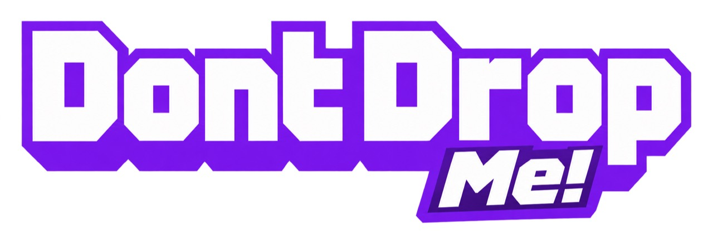

# DontDropMe!

## Your chat is in your hands. One of them is lying.

Four viewers become tiny characters on the streamer's webcam. Three know a secret word. One is bluffing. The streamer lifts each player with a real hand, hears their clue, watches chat take sides, and carries them toward safety or the Impostor cave. Find the liar and they can still make a break for it. Now you have to pinch them out of the air.

**DontDropMe! turns social deduction into physical comedy: a community game where trust has weight, accusations have consequences, and the host's hand delivers the verdict.**

<p align="center">
  
</p>

Built with **OpenAI Codex** for the **Codex x TwitchCon Hackathon**.

[Try it locally](#play-it-now) · [Connect Twitch](#bring-your-community-in) · [Inside the build](#engineering-the-live-moment) · [Twitch setup details](TWITCH_SETUP.md)

## A bluff you can hold

A poll asks chat to choose. DontDropMe! makes the streamer live with the choice, with the accused standing on their palm.

- **The streamer is the stage and the controller.** Move a hand beneath a character, lift them, navigate the playground, and deliver them to a cave. Your face, hesitation, and movements become part of the show.
- **Selected viewers are the cast.** Private companion pages deliver the secret word or impostor role. Players submit clues and answers, protecting their identity while trying to influence the host.
- **Chat is the jury.** `!trust` and `!drop` feed a live vote display. The crowd can rally behind a convincing bluff or spot what the streamer misses. The verdict still belongs to the hand.

The tension comes from two skills colliding: reading people and keeping them steady. A good argument can save a suspicious player. A shaky hand can make a confident host look very nervous.

## Picture this on the TwitchCon stage

Four audience members join. Three receive the same word on their private pages; the fourth receives the impostor role and only the category.

The streamer scoops up the first tiny contestant. Their clue appears. Chat starts building a case. A second player offers something suspiciously vague, and the vote swings toward **Impostor**. The host pauses with that player balanced above the caves, deciding whether to trust the room or their own instincts.

Then comes the reveal. If the impostor is caught without winning by guessing the word, the interrogation becomes a chase. The little liar bolts toward safety. The streamer reaches across the webcam, pinches thumb and finger around them, and carries them back to the Impostor cave to finish the job.

**The audience can understand the spectacle before they know the rules: someone tiny is lying, someone enormous is deciding, and everyone has an opinion.**

That is the live-demo promise. One frame explains the premise. One accusation creates a rivalry. One escape gives the room a reason to shout.

## Built for the people watching

The webcam sits inside the playfield, so the host's reaction and the consequence of their decision share the same frame. Named, colored characters give the audience someone to follow. Contrasting Safe and Impostor caves make the stakes legible. Coin trails and tumbling toy towers turn the journey between decisions into its own visual performance.

The round moves through private roles, clues, interrogation, decisions, and a possible escape. Picking up a player reveals their clue and opens voting, tying the conversation to a visible action. A vote chart makes disagreement readable at a glance. Private role pages preserve the bluff; a separate read-only broadcast view supports showing the shared game.

For streamers, the format creates a recurring community segment with a new cast and new suspicions. For viewers, participation has a face and a consequence. Even people who never join can follow the argument, influence the vote, and wait to see whether the host was right.

## Engineering the live moment

**A webcam becomes a physical controller.** MediaPipe hand landmarks run in the browser, mapping the palm into the Phaser playfield and measuring thumb-to-finger distance relative to hand size for pinch detection. Camera frames stay on the device. Bundled model assets, GPU-to-CPU fallback, and adaptive inference scheduling support the interaction without a cloud vision round trip. Mouse Mode provides a rehearsal fallback.

**Twitch identity connects the crowd to the game.** OAuth and Helix identify the broadcaster and players; EventSub WebSockets bring in actual channel chat. `!join` registers interest, and four authenticated, connected, ready viewers are randomly selected. Votes use Twitch user IDs, with one current vote per viewer per character. Changing your mind replaces your vote. The adapter handles duplicate notifications, reconnection, token refresh, and revocation.

**Secrets and shared spectacle travel separately.** A TypeScript room state machine controls roles, phases, votes, and outcomes. Socket.IO distributes public state, private player information, and host simulation state to their intended clients. Action IDs and state versions help reject repeated or stale actions. The host runs the physical simulation and sends character positions; the server checks the conditions for deliveries and captures.

**The playground has physical consequences.** A separately stepped Matter physics world gives toy blocks, triangles, and balls rotation, contact resistance, and collapse. The scenery becomes something to bump, disturb, and perform around while the social game unfolds.

## Built with Codex, from hand tracking to trust issues

Codex was the development partner across the game's interaction, multiplayer systems, and presentation. The repository's build history traces concrete iterations: a playable hand-controlled foundation; private multiplayer roles and an escape chase; a one-tab rehearsal cast; interrogation while characters ride the hand; and live Twitch integration alongside the interactive playground.

That work spans the TypeScript room state machine, webcam-to-game coordinate mapping, gesture controls, Twitch authentication and chat handling, browser interfaces, and automated tests. The result brings computer vision, physical play, and social deduction into one coherent streaming experience.

**Codex helped build the game.** Runtime hand tracking uses MediaPipe, and the solo rehearsal uses scripted players and dialogue. No OpenAI API key is required to run it.

Main Codex build session: `01a19a55-5b2b-7cc0-872d-82ee72fdf44d`

## Play it now

Use **Node.js 24 LTS** and npm. A webcam gives you the signature experience; Mouse Mode lets you explore without one.

```sh
git clone https://github.com/yasser-noori/DontDropMe.git
cd DontDropMe
npm ci
npm run dev
```

Open **http://localhost:5173**. With no `.env` file, no Twitch credentials are needed for rehearsal.

| Mode | How to start | What you are playing |
| --- | --- | --- |
| Solo rehearsal | **Play** or **Play solo demo** | Scripted players, dialogue, and simulated audience activity. Explore the hand controls and full game loop in one tab. |
| Local multiplayer | **Play with friends** | Use the generated private player links for four browser sessions. No Twitch authentication. |
| Live Twitch | **Create Twitch Room** | Real Twitch joins and votes, authenticated players, and private companion pages. Requires the configuration below. |

Choose **Start Camera** and grant webcam access, or choose **Mouse Mode**. Lift a character from below, read their clue, and guide them to a destination. During an escape, pinch around the impostor and return them to the Impostor cave. Press **P** to pause.

Camera access requires localhost or HTTPS. For players on other devices, expose the server through your own HTTPS reverse proxy or tunnel and configure its origin. The server binds to `127.0.0.1`.

## Bring your community in

1. Register a confidential application in the [Twitch developer console](https://dev.twitch.tv/console/apps).
2. Create a local `.env` file with these variables. Replace the example origin with your own reachable HTTPS address:

   ```dotenv
   PORT=4173
   PUBLIC_ORIGIN=https://your-game.example
   TWITCH_CLIENT_ID=your_client_id
   TWITCH_CLIENT_SECRET=your_client_secret
   ```

3. Register the exact OAuth redirect URL **`https://your-game.example/auth/twitch/callback`** for that application. Route the public HTTPS address to your local port `4173`.
4. Run `npm run build`, then `npm start`. Open your configured public URL, choose **Create Twitch Room**, then **Connect my Twitch channel**. The broadcaster grants `user:read:chat`; the app does not request permission to post chat messages.
5. Share the generated **Viewer join page**. Viewers type `!join` in the connected Twitch channel, open that page, sign in with the same Twitch account, and press **Ready**. Four eligible viewers are selected automatically.
6. During voting, **`!trust` = not the impostor** and **`!drop` = impostor**. The streamer chooses the destination regardless of the majority vote.

Keep `.env` local; it is gitignored. Restart the server after configuration changes. `PORT` also overrides the development port, so use `http://localhost:4173` if you run development with the configuration above.

For OAuth lifecycle details and a real-chat acceptance walkthrough, see [TWITCH_SETUP.md](TWITCH_SETUP.md). Live mode does not generate rehearsal votes or synthetic join messages. A full live check requires broadcaster authorization and four viewer accounts.

### Checks and operating notes

```sh
npm test -- --run
npm run build
```

The test suite covers gameplay, hand platforms, voting, escape gestures, toy physics, and Twitch event handling. Target the Twitch and game-state checks with `npm test -- --run tests/twitch.test.ts tests/trust-fall.test.ts`. Known failures were observed in escape-path and toy-physics tests during repository preparation; a passing full suite is not claimed.

Rooms and authorization tokens live in memory in one server process. Restarting clears sessions. Physical positions are reported by the trusted host. The Twitch-style interface is the game shell, not an embedded Twitch video player; example channel listings are decorative.

### Submission media

The repository includes the [wordmark](public/assets/branding/dont-drop-me-wordmark.jpg), [transparent icon](public/assets/branding/dont-drop-me-icon-transparent.png), and cave artwork used in the game. A public gameplay video and a verified public live-demo URL have not yet been supplied.

The strongest recording sequence is already in the game: **real chat joins → private roles → a viewer on the host's hand → chat votes → a cave verdict → the pinch-and-return chase**, followed by a brief look at the Codex build session.

**Give chat a body. Give the streamer a dilemma. Let the room decide who to believe.**
